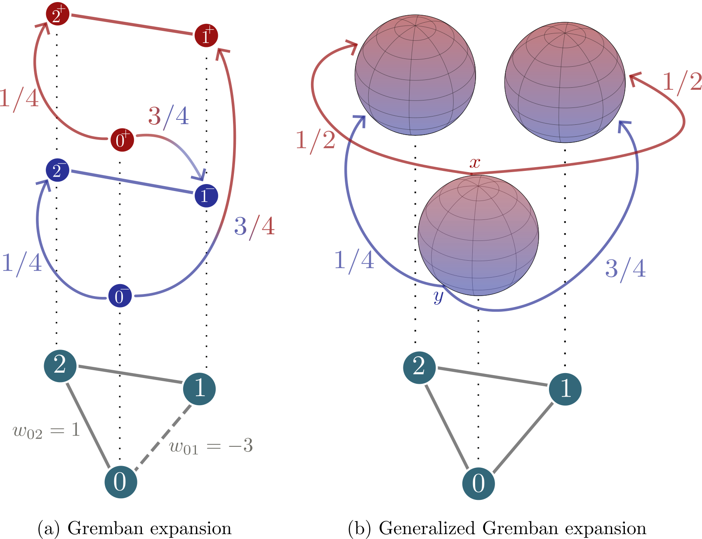

# A Bochner–Weitzenböck Decomposition for Cellular Sheaf Laplacians, Curvature and Neural Sheaf Diffusion

Francesco Maria Guadagnuolo<sup>1,2</sup>, Alessio Borgi<sup>1,3</sup>, Dorina Thanou<sup>4</sup>, Pietro Liò<sup>3</sup>

<sup>1</sup> Sapienza University of Rome &nbsp; <sup>2</sup> Italian Institute of Artificial Intelligence (AI4I) &nbsp; <sup>3</sup> University of Cambridge &nbsp; <sup>4</sup> EPFL

[](https://arxiv.org/abs/2610.28455)
[](https://doi.org/10.5281/zenodo.23080428)


[](LICENSE)

## Overview

This is the official code of the paper *A Bochner–Weitzenböck Decomposition for Cellular
Sheaf Laplacians, Curvature and Neural Sheaf Diffusion*.

> We extend the Bochner–Weitzenböck decomposition to cellular sheaf Laplacians, splitting
> it into a positive semidefinite term, the Bochner sheaf Laplacian, and a block diagonal
> term, the Forman curvature. We show that the Bochner Laplacians form a class of cellular
> sheaves that extends both connection and matrix-weighted Laplacians, and generalizes
> signed graphs to *d* dimensions. We give a holonomy characterization of their kernel,
> prove the related Cheeger inequalities, and attach to them a random walk that
> generalizes the Gremban expansion. For the Forman term, we prove a discrete Bochner
> theorem, which bounds the first cohomology of a cellular sheaf with nonnegative
> curvature, and we read the whole decomposition as an opinion-dynamics model. We then
> apply this machinery to Sheaf Neural Networks, whose learnt Laplacian is otherwise
> unobserved. The Bochner interpretation yields a node-level conviction score that acts as
> an operational importance measure under frozen-model interventions, while the Forman
> profile provides a local descriptor of the learnt operator.

<p align="center">
  
</p>

*The random walk of a Bochner matrix as a generalized Gremban expansion (Figure 2 of the
paper). On a signed graph (a) every node is doubled into two copies, and crossing a
negative edge flips the copy the walker is on. For d > 1 (b) every node is lifted to a
whole sphere, and the probability of each jump depends on the direction the walker
carries.*

This repository is a fork of [Neural Sheaf Diffusion](https://github.com/twitter-research/neural-sheaf-diffusion)
(Bodnar et al., NeurIPS 2022). We keep their models and training loop, and add what is
needed to look inside a trained network, together with the two experiments of the paper.

## Getting started

To get the environment we used:

```bash
conda env create -f src/environments/environment_nsd_exact.yml
conda activate nsd
```

Without CUDA, use the upstream environment and add the analysis packages:

```bash
conda env create -f environment_cpu.yml
conda activate nsd
pip install -r src/requirements-analysis.txt
```

Training logs go to Weights & Biases; if you don't have an account, run
`export WANDB_MODE=disabled` first.

On Windows, clone the repository into a short folder such as `C:\nsd`
(`git clone -c core.longpaths=true <url> C:\nsd`): some paths are long, and Windows refuses
paths over 260 characters by default.

## Quick start

Train one of the paper's models, the sheaf network on Cornell:

```bash
python -m exp.run --dataset=cornell --model=GeneralSheaf --normalised=True \
    --d=2 --layers=2 --hidden_channels=16 --epochs=500 --lr=0.02 \
    --weight_decay=0.0006914841722570725 --sheaf_decay=0.00031764232712732976 \
    --dropout=0.5 --input_dropout=0.2 \
    --checkpoint_epochs=0,1,5,15,50,200 --save_norms=False --save_others=True
```

## Reproducing the paper

There are three ways in, depending on how far back you want to go. The full guide is in
[`src/README.md`](src/README.md).

1. **Regenerate the tables.** All 23 tables of the paper can be rebuilt from the per-fold
   data committed here, with four pip packages.
2. **Rerun the analysis.** The raw outputs of the trained models are on
   [Zenodo](https://doi.org/10.5281/zenodo.23080428) (6.8 GB). Unpack them at the root of
   the repository and run the analysis scripts.
3. **Retrain the models.** [`src/TRAINING_RUNS.md`](src/TRAINING_RUNS.md)
   lists every trained model with the exact command that produced it, and
   `exp/scripts/paper/` collects them in scripts.

## Layout

```
src/              everything specific to the paper (start here)
  conviction/              node importance in a trained network (Bochner term)
  forman_profile/          spectra of the curvature blocks (Forman term)
  TRAINING_RUNS.md         every trained model, with its command
  environments/            the conda environments we used
exp/ lib/ models/ utils/   the Neural Sheaf Diffusion code, with our additions
exp/scripts/paper/         training scripts for the paper's models
datasets/ splits/          benchmark data and the 10-fold splits
```

## What we changed in Neural Sheaf Diffusion

Our changes are almost all additions, and each modified file says so in its header.

| File | What we added |
|---|---|
| `exp/run.py` | checkpoints during training, and saving of the Forman eigenvalues, node norms, confidences, predictions, saliencies and weights |
| `utils/conviction.py` (new) | loading trained models, ranking nodes, and the three interventions of the conviction experiment (masking, gating, pruning) |
| `models/disc_models.py` | the identity-sheaf model, access to the Laplacian and the node norms at each layer, and the hook used to gate messages |
| `models/laplacian_builders.py` | the option to use unnormalised Laplacians |
| `utils/heterophilic.py` | loaders for Roman Empire, Amazon Ratings, Minesweeper, Tolokers and Questions |
| `exp/parser.py` | the flags for saving outputs and checkpoints |

The construction of the sheaf Laplacian itself (`lib/`) is unchanged.

## Citation

If you find this work useful, please cite:

```bibtex
@misc{guadagnuolo2026bochnerweitzenbockdecompositioncellular,
      title={A Bochner Weitzenb\"ock Decomposition for Cellular Sheaf Laplacians, Curvature and Neural Sheaf Diffusion},
      author={Francesco Maria Guadagnuolo and Alessio Borgi and Dorina Thanou and Pietro Liò},
      year={2026},
      eprint={2610.28455},
      archivePrefix={arXiv},
      primaryClass={cs.CG},
      url={https://arxiv.org/abs/2610.28455},
}
```

Please also cite [Neural Sheaf Diffusion](https://arxiv.org/abs/2202.04579) (Bodnar et al., NeurIPS 2022), on which this code is built.

## License

Apache 2.0, the same as Neural Sheaf Diffusion; see [`LICENSE`](LICENSE).
