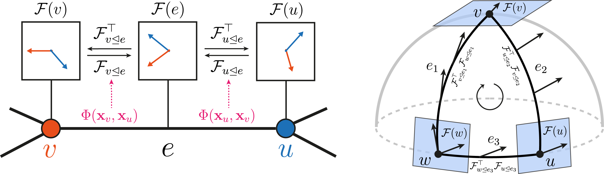

# A Bochner–Weitzenböck Decomposition for Cellular Sheaf Laplacians, Curvature and Neural Sheaf Diffusion

Francesco Maria Guadagnuolo<sup>1,2</sup>, Alessio Borgi<sup>1,3</sup>, Dorina Thanou<sup>4</sup>, Pietro Liò<sup>3</sup>

<sup>1</sup> Sapienza University of Rome &nbsp; <sup>2</sup> Italian Institute of Artificial Intelligence (AI4I) &nbsp; <sup>3</sup> University of Cambridge &nbsp; <sup>4</sup> EPFL

[](https://arxiv.org/abs/2610.28455)
[](https://doi.org/10.5281/zenodo.23080428)


[](LICENSE)

## Overview

This is the official code of the paper *A Bochner–Weitzenböck Decomposition for Cellular
Sheaf Laplacians, Curvature and Neural Sheaf Diffusion*.

> We extend the Bochner–Weitzenböck decomposition to cellular sheaf Laplacians, splitting
> it into a positive semidefinite term, the Bochner sheaf Laplacian, and a block diagonal
> term, the Forman curvature. We show that the Bochner Laplacians form a class of cellular
> sheaves that extends both connection and matrix-weighted Laplacians, and generalizes
> signed graphs to *d* dimensions. We give a holonomy characterization of their kernel,
> prove the related Cheeger inequalities, and attach to them a random walk that
> generalizes the Gremban expansion. For the Forman term, we prove a discrete Bochner
> theorem, which bounds the first cohomology of a cellular sheaf with nonnegative
> curvature, and we read the whole decomposition as an opinion-dynamics model. We then
> apply this machinery to Sheaf Neural Networks, whose learnt Laplacian is otherwise
> unobserved. The Bochner interpretation yields a node-level conviction score that acts as
> an operational importance measure under frozen-model interventions, while the Forman
> profile provides a local descriptor of the learnt operator.

<p align="center">
  
</p>

*The random walk of a Bochner matrix as a generalized Gremban expansion (Figure 2 of the
paper). On a signed graph (a) every node is doubled into two copies, and crossing a
negative edge flips the copy the walker is on. For d > 1 (b) every node is lifted to a
whole sphere, and the probability of each jump depends on the direction the walker
carries.*

This repository is a fork of [Neural Sheaf Diffusion](https://github.com/twitter-research/neural-sheaf-diffusion)
(Bodnar et al., NeurIPS 2022). We keep their models and training loop, and add what is
needed to look inside a trained network, together with the two experiments of the paper.
Their original README is kept, unchanged, at the [end of this page](#original-neural-sheaf-diffusion-readme).

## Getting started

We ran everything on Linux with an NVIDIA GPU. To get the same environment:

```bash
conda env create -f Bochner_code/environments/environment_nsd_exact.yml
conda activate nsd
```

If you only have a CPU, use the upstream environment and add the analysis packages:

```bash
conda env create -f environment_cpu.yml
conda activate nsd
pip install -r Bochner_code/requirements-analysis.txt
```

Training logs go to Weights & Biases; if you don't have an account, run
`export WANDB_MODE=disabled` first.

On Windows, clone the repository into a short folder such as `C:\nsd`
(`git clone -c core.longpaths=true <url> C:\nsd`): some paths are long, and Windows refuses
paths over 260 characters by default.

## Quick start

Train a sheaf model on Cornell and save everything the analysis needs:

```bash
python -m exp.run --dataset=cornell --model=GeneralSheaf --normalised=True \
    --d=2 --layers=2 --hidden_channels=16 --epochs=500 --lr=0.02 \
    --checkpoint_epochs=0,1,5,15,50,200 --save_others=True
```

This takes a few minutes on a CPU and writes into `results/` the model weights, the
eigenvalues of the Forman curvature at each layer and checkpoint, and the per-node norms,
confidences, predictions and saliencies of each of the ten folds.

## Reproducing the paper

There are three ways in, depending on how far back you want to go. The full guide is in
[`Bochner_code/README.md`](Bochner_code/README.md).

1. **Regenerate the tables.** All 23 tables of the paper can be rebuilt in about a minute
   from the per-fold data committed here, with four pip packages and no GPU.
2. **Rerun the analysis.** The raw outputs of the trained models are on
   [Zenodo](https://doi.org/10.5281/zenodo.23080428) (6.8 GB). Unpack them at the root of
   the repository and run the analysis scripts.
3. **Retrain the models.** [`Bochner_code/TRAINING_RUNS.md`](Bochner_code/TRAINING_RUNS.md)
   lists every trained model with the exact command that produced it, and
   `exp/scripts/paper/` collects them in scripts.

## Layout

```
Bochner_code/              everything specific to the paper (start here)
  conviction/              node importance in a trained network (Bochner term)
  forman_profile/          spectra of the curvature blocks (Forman term)
  TRAINING_RUNS.md         every trained model, with its command
  environments/            the conda environments we used
exp/ lib/ models/ utils/   the Neural Sheaf Diffusion code, with our additions
exp/scripts/paper/         training scripts for the paper's models
datasets/ splits/          benchmark data and the 10-fold splits
```

## What we changed in Neural Sheaf Diffusion

Our changes are almost all additions, and each modified file says so in its header.

| File | What we added |
|---|---|
| `exp/run.py` | checkpoints during training, and saving of the Forman eigenvalues, node norms, confidences, predictions, saliencies and weights |
| `utils/conviction.py` (new) | loading trained models, ranking nodes, and the three interventions of the conviction experiment (masking, gating, pruning) |
| `models/disc_models.py` | the identity-sheaf model, access to the Laplacian and the node norms at each layer, and the hook used to gate messages |
| `models/laplacian_builders.py` | the option to use unnormalised Laplacians |
| `utils/heterophilic.py` | loaders for Roman Empire, Amazon Ratings, Minesweeper, Tolokers and Questions |
| `exp/parser.py` | the flags for saving outputs and checkpoints |

The construction of the sheaf Laplacian itself (`lib/`) is unchanged.

## Citation

If you find this work useful, please cite:

```bibtex
@misc{guadagnuolo2026bochnerweitzenbockdecompositioncellular,
      title={A Bochner Weitzenb\"ock Decomposition for Cellular Sheaf Laplacians, Curvature and Neural Sheaf Diffusion},
      author={Francesco Maria Guadagnuolo and Alessio Borgi and Dorina Thanou and Pietro Liò},
      year={2026},
      eprint={2610.28455},
      archivePrefix={arXiv},
      primaryClass={cs.CG},
      url={https://arxiv.org/abs/2610.28455},
}
```

Please also cite Neural Sheaf Diffusion, whose citation is in the original README below.

## License

Apache 2.0, the same as Neural Sheaf Diffusion; see [`LICENSE`](LICENSE).

---

## Original Neural Sheaf Diffusion README

*Kept unchanged from [twitter-research/neural-sheaf-diffusion](https://github.com/twitter-research/neural-sheaf-diffusion).*

[](https://github.com/twitter-research/neural-sheaf-diffusion/actions) 
[](https://github.com/twitter-research/neural-sheaf-diffusion/blob/main/LICENSE)

# Neural Sheaf Diffusion

This repository contains the official code for the paper 
**[Neural Sheaf Diffusion: A Topological Perspective on Heterophily and Oversmoothing in GNNs](https://arxiv.org/abs/2202.04579) (NeurIPS 2022)**.



## Getting started

We used `CUDA 10.2` for this project. To set up the environment, run the following command:

```bash
conda env create --file=environment_gpu.yml
conda activate nsd
```
For using another `CUDA` version, modify the version specified inside `environment_gpu.yml`. If you like to run 
the code in a CPU-only environment, then use `environment_cpu`. 

To make sure that everything is set up correctly, you can run all the tests using:
```bash
pytest -v .
```

## Running experiments

To run the experiments without a Weights & Biases (wandb) account, first disable `wandb` by running `wandb disabled`. 
Then, for instance, to run the training procedure on `texas`, simply run the example script provided:
```commandline
sh ./exp/scripts/run_texas.sh
```

To run the experiments using `wandb`, first create a [Weights & Biases account](https://wandb.ai/site). Then run the following
commands to log in and follow the displayed instructions:
```bash
wandb online
wandb login
```
Then, you can run the example training procedure on `texas` via:
```bash
export ENTITY=<WANDB_ACCOUNT_ID>
sh ./exp/scripts/run_texas.sh
```
Scripts for the other heterophilic datasets are also provided in `exp/scripts`. 

### Hyperparameter Sweeps

To run a hyperparameter sweep, you will need a `wandb` account. Once you have an account, you can run an example
sweep as follows:
```bash
export ENTITY=<WANDB_ACCOUNT_ID>
wandb sweep --project sheaf config/orth_webkb_sweep.yml
```
This will set up the sweep for a discrete bundle model on the WebKB datasets 
as described in the yaml config at `config/orth_webkb_sweep.yml`.

To run the sweep on a single GPU, simply run the command displayed on screen after running the sweep command above. 
If you like to run the sweep on multiple GPUs, then run the following command by typing in the `SWEEP_ID` received above.
```bash
sh run_sweeps.sh <SWEEP_ID>
```
### Datasets

The WebKB (`texas`, `wisconsin`, `cornell`) and `film` datasets are downloaded on the fly. The
[WikipediaNetwork datasets](https://academic.oup.com/comnet/article/9/2/cnab014/6271062) with the Geom-GCN pre-processing 
can be downloaded from the [Geom-GCN repo](https://github.com/graphdml-uiuc-jlu/geom-gcn/tree/f1fc0d14b3b019c562737240d06ec83b07d16a8f/new_data).
The files for the Planetoid datasets can also be found in the [Geom-GCN repo](https://github.com/graphdml-uiuc-jlu/geom-gcn/tree/master/data). 
The downloaded files must be placed into `datasets/<DATASET_NAME>/raw/`.

## Credits

For attribution in academic contexts, please use the bibtex entry below:
```
@inproceedings{
 bodnar2022neural,
 title={Neural Sheaf Diffusion: A Topological Perspective on Heterophily and Oversmoothing in {GNN}s},
 author={Cristian Bodnar and Francesco Di Giovanni and Benjamin Paul Chamberlain and Pietro Li{\`o} and Michael M. Bronstein},
 booktitle={Advances in Neural Information Processing Systems},
 editor={Alice H. Oh and Alekh Agarwal and Danielle Belgrave and Kyunghyun Cho},
 year={2022},
 url={https://openreview.net/forum?id=vbPsD-BhOZ}
}
```
